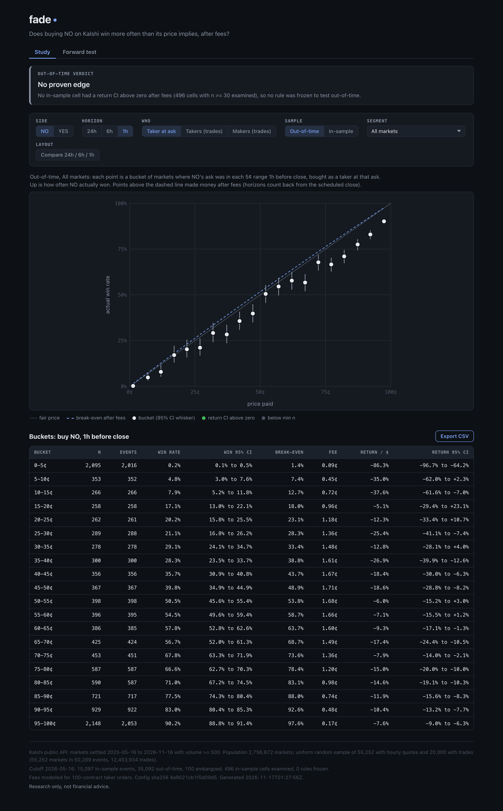
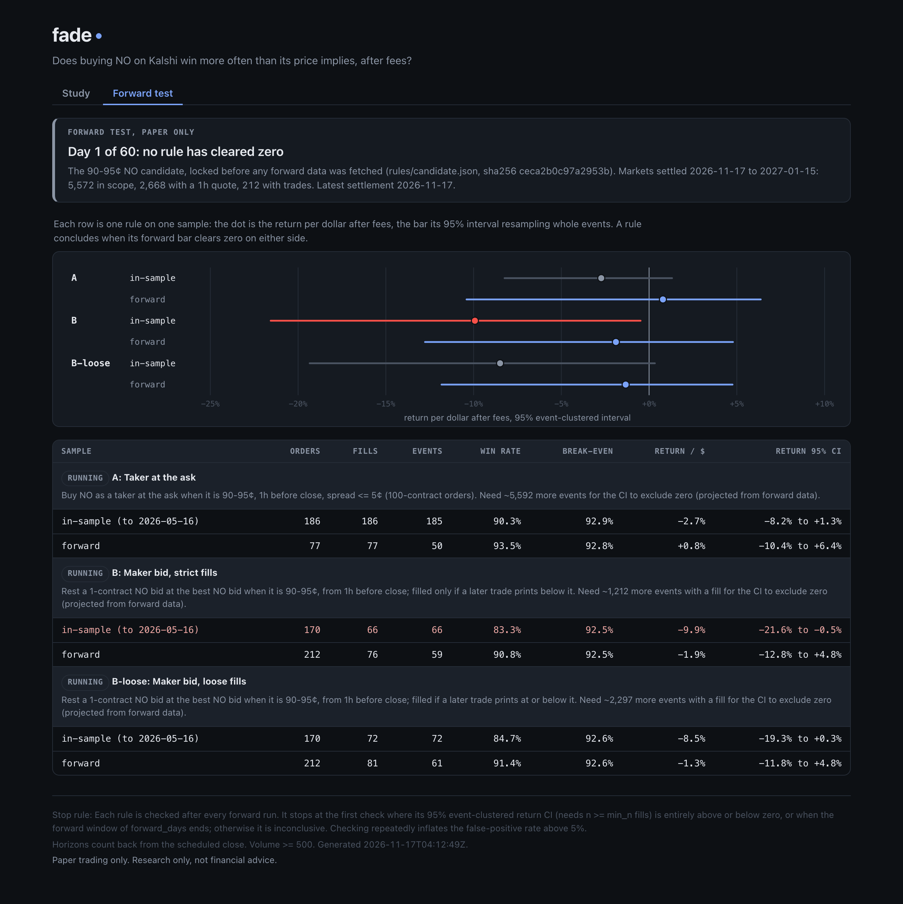
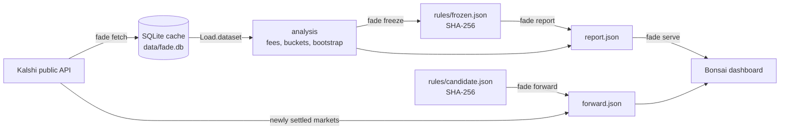

# fade

**Does buying NO on Kalshi win more often than its price implies, after fees?** An out-of-time test with frozen rules, written in OCaml.

[](https://github.com/aryamanchhikara/fade/actions/workflows/ci.yml)
[](LICENSE)
[](https://ocaml.org)



> **Result: no proven edge.** Rules were chosen on the 15,097 events that settled before 2026-05-16. None of the 496 NO-side cells with n ≥ 30 had a 95% return interval above zero after fees, so the frozen rule set is empty and nothing could pass out-of-time. On the 35,092 out-of-time events (2026-05-16 to 2026-11-16), buying NO as a taker at the ask 1h before close lost money in all 20 price buckets (from -5.1% to -86.3% per dollar), and 14 of the 20 have their whole interval below zero. Buying YES at the ask was worse: 19 of 20 below zero.

<details>
<summary>Out-of-time table: buy NO as a taker at the ask, 1h before close, all markets</summary>

| Bucket | n | Events | NO win rate | Break-even | Fee | Return / $ | 95% CI (event-clustered) |
| --- | ---: | ---: | ---: | ---: | ---: | ---: | --- |
| 0-5¢ | 2,095 | 2,016 | 0.2% | 1.4% | 0.09¢ | -86.3% | -96.7% to -64.2% |
| 5-10¢ | 353 | 352 | 4.8% | 7.4% | 0.45¢ | -35.0% | -62.0% to +2.2% |
| 10-15¢ | 266 | 266 | 7.9% | 12.7% | 0.72¢ | -37.6% | -61.6% to -7.0% |
| 15-20¢ | 258 | 258 | 17.1% | 18.0% | 0.96¢ | -5.1% | -29.4% to +23.1% |
| 20-25¢ | 262 | 261 | 20.2% | 23.1% | 1.18¢ | -12.3% | -33.4% to +10.7% |
| 25-30¢ | 289 | 288 | 21.1% | 28.3% | 1.36¢ | -25.4% | -41.1% to -7.4% |
| 30-35¢ | 278 | 278 | 29.1% | 33.4% | 1.48¢ | -12.8% | -28.1% to +4.0% |
| 35-40¢ | 300 | 300 | 28.3% | 38.8% | 1.61¢ | -26.9% | -39.9% to -12.6% |
| 40-45¢ | 356 | 356 | 35.7% | 43.7% | 1.67¢ | -18.4% | -30.0% to -6.3% |
| 45-50¢ | 367 | 367 | 39.8% | 48.9% | 1.71¢ | -18.6% | -28.8% to -8.2% |
| 50-55¢ | 398 | 398 | 50.5% | 53.8% | 1.68¢ | -6.0% | -15.2% to +3.0% |
| 55-60¢ | 396 | 395 | 54.5% | 58.7% | 1.66¢ | -7.1% | -15.5% to +1.2% |
| 60-65¢ | 386 | 385 | 57.8% | 63.7% | 1.60¢ | -9.3% | -17.1% to -1.3% |
| 65-70¢ | 425 | 424 | 56.7% | 68.7% | 1.49¢ | -17.4% | -24.4% to -10.5% |
| 70-75¢ | 453 | 451 | 67.8% | 73.6% | 1.36¢ | -7.9% | -14.0% to -2.1% |
| 75-80¢ | 587 | 587 | 66.6% | 78.4% | 1.20¢ | -15.0% | -20.0% to -10.0% |
| 80-85¢ | 590 | 587 | 71.0% | 83.1% | 0.98¢ | -14.6% | -19.1% to -10.3% |
| 85-90¢ | 721 | 717 | 77.5% | 88.0% | 0.74¢ | -11.9% | -15.6% to -8.3% |
| 90-95¢ | 929 | 922 | 83.0% | 92.6% | 0.48¢ | -10.4% | -13.2% to -7.7% |
| 95-100¢ | 2,148 | 2,053 | 90.2% | 97.6% | 0.17¢ | -7.6% | -9.0% to -6.3% |

Fee is per contract for a 100-contract taker order. Break-even is the win rate needed to cover price plus fee.
</details>

### What else the data shows (exploratory, not tested)

These came out of looking at the full report after the rules were frozen. None of them is a result.

- **The 90-95¢ NO fills: a pre-registered candidate under forward test.** Whoever ended up holding NO at 90-95¢ in the last hour made money, whether they took the trade (+3.1% per dollar out-of-time, 95% CI +0.7% to +5.1%) or made it (+4.9%, +2.5% to +6.5%), and the same cells were positive in-sample. The study window has now been looked at, so it cannot confirm this. Two executable versions were locked in [`rules/candidate.json`](rules/candidate.json) (sha256 `ceca2b0c97a2953ba0b7dbf23e5026b0bcfd7273379133ea2d5ab492b9fa467a`) before any newer data was fetched, and are being [forward-tested](#forward-test) on markets settled from 2026-11-17. As one order per market an hour before close, neither made money in-sample.
- **Thin books.** At 1h before close, 64.8% of the 23,283 sampled markets with a quote had no tight book: 37.7% were one-sided, and 43.5% of the two-sided ones were wider than 5¢ (by category below; `fade spreads` prints it). Quote cells weight every sampled market equally, so many are thin; fills are weighted by contracts and come from markets where people trade. An ask in a thin book is not a probability: with a 3¢ bid and a 97¢ ask, both YES and NO cost 97¢. In a one-off check of in-sample 1h quotes, YES asks at 95-99¢ won 97% of the time when the spread was at most 5¢ (230 quotes) and 66% when it was wider (512).
- **One out-of-time quote cell cleared zero:** NO at 20-25¢, 24h before close, top volume tercile (n = 103, +50.8%, CI +11.8% to +92.2%). That is 1 of 586 out-of-time NO cells across all horizons and segments, about what chance alone produces.

<details>
<summary>The book 1h before close, by category (sampled markets, whole window)</summary>

| Category | Quoted | One-sided | Two-sided, spread > 5¢ | Not tight (either) |
| --- | ---: | ---: | ---: | ---: |
| All categories | 23,283 | 37.7% | 43.5% | 64.8% |
| Sports | 18,618 | 32.0% | 43.9% | 61.8% |
| Climate and Weather | 1,193 | 89.9% | 48.8% | 94.8% |
| Commodities | 902 | 33.6% | 53.8% | 69.3% |
| Financials | 768 | 36.2% | 26.3% | 53.0% |
| Crypto | 691 | 67.0% | 41.2% | 80.6% |
| Economics | 495 | 51.7% | 41.0% | 71.5% |
| Entertainment | 265 | 72.5% | 43.8% | 84.5% |
| Mentions | 196 | 88.8% | 27.3% | 91.8% |
| Politics | 96 | 43.8% | 27.8% | 59.4% |
| Science and Technology | 42 | 85.7% | 33.3% | 90.5% |
| Elections | 15 | 40.0% | 33.3% | 60.0% |

Health and World had one quoted market each. "Two-sided, spread > 5¢" is a share of the two-sided books.
</details>

## Forward test



The candidate is being paper-traded on markets that settle after the study window. No orders are placed.

| Rule | Definition (1h before the scheduled close, volume ≥ 500) |
| --- | --- |
| A, taker | Buy NO at the ask when the NO ask is 90-95¢ and the spread is at most 5¢. Fees for 100-contract orders. |
| B, maker | Rest a 1-contract NO bid at the best NO bid when it is 90-95¢. Filled only if a later trade before close prints strictly below it. |
| B-loose, maker | As B, but a trade at our price also counts as a fill. |

**Locked first.** [`rules/candidate.json`](rules/candidate.json) (sha256 `ceca2b0c97a2953ba0b7dbf23e5026b0bcfd7273379133ea2d5ab492b9fa467a`) holds the rules, the config and the in-sample numbers below. It was committed and pushed before `fade forward` fetched anything, and `fade forward` refuses a file that no longer matches its hash.

**In-sample** (the study's in-sample events, settled before 2026-05-16; B uses the trade sample, since a fill needs every trade):

| Rule | Orders | Fills | Win rate | Break-even | Return / $ | 95% CI (event-clustered) |
| --- | ---: | ---: | ---: | ---: | ---: | --- |
| A | 186 | 186 | 90.3% | 92.9% | -2.7% | -8.2% to +1.3% |
| B | 170 | 66 | 83.3% | 92.5% | -9.9% | -21.6% to -0.5% |
| B-loose | 170 | 72 | 84.7% | 92.6% | -8.5% | -19.3% to +0.3% |

The resting bid shows adverse selection: it fills when the price trades through it, and those fills won 83% of the time against a 92.5% break-even.

**Window and stopping.** Markets settled 2026-11-17 to 2027-01-15 (60 days), the whole population rather than a sample. After each run the tab shows each rule's return per dollar, its event-clustered CI and roughly how many more events it needs for the CI to exclude zero. A rule stops at the first run where its CI clears zero on either side; otherwise it is inconclusive when the 60 days end. Checking after every run raises the false-positive rate above the nominal 5%, so a rule that clears zero early deserves a second, fixed-length test.

```sh
make forward           # fetch newly settled markets, score, write web/data/forward.json
make forward-install   # optional: run it daily at 06:30 with launchd (macOS); make forward-uninstall
```

### The pinned study

| | |
| --- | --- |
| Data window | Kalshi markets settled 2025-05-16 to 2026-11-16 with lifetime volume ≥ 500 contracts (applied when listing, so every sampled market meets it): 2,756,872 markets |
| Quote sample | 55,252 markets (2%, uniform by MD5 of the ticker) in 50,289 events |
| Trade sample | 20,000 markets (the first 20,000 in the same order), 12,453,934 trades |
| Split | cutoff 2026-05-16: 15,097 in-sample events, 35,092 out-of-time, 100 embargoed |
| Frozen config | [`rules/frozen.json`](rules/frozen.json), sha256 `4a9021cb1f5d09d5ca53951ad7b6468f2baa7b0336dc5e8d4efc8e0e00498e54` |

`make reproduce` refuses to run if the frozen file's hash differs from the one above, and `fade report` refuses a frozen file whose contents no longer match its own hash. On the existing cache it regenerates an identical report: a completed listing is never extended, so the samples cannot shift. A fresh fetch lists markets settled through the end of 2026-11-16 (`--until`). The cache behind these numbers was listed at 21:10 UTC that day, so a fresh run can include a few more markets from that evening, and Kalshi's archive may change.

## Quickstart

```sh
git clone https://github.com/aryamanchhikara/fade && cd fade
opam switch create . ocaml-base-compiler.5.1.1 --deps-only --yes   # OCaml + deps, local to the repo
make demo                       # dashboard on synthetic data: http://localhost:8080
make reproduce && make serve    # the real study (the fetch takes many hours; resumable)
```

Needs opam 2.1 or later, plus Node 22 and Google Chrome for the figures. On macOS, install the C libraries first and put the keg-only ones where `pkg-config` can see them:

```sh
brew install opam pkgconf gmp sqlite libffi zlib openssl@3
export PKG_CONFIG_PATH="$(brew --prefix zlib)/lib/pkgconfig:$(brew --prefix libffi)/lib/pkgconfig:$(brew --prefix sqlite)/lib/pkgconfig:$(brew --prefix openssl@3)/lib/pkgconfig"
```

## How it works



- **`fade fetch`** lists every settled market in the window from Kalshi's public API (no account needed), then fetches hourly candles for the quote sample and every public fill for the trade sample. It is resumable and idempotent, backs off on 429s and shows a progress bar.
- **`fade freeze`** builds in-sample tables only, selects rules and writes them with a hash.
- **`fade report`** checks the hash, builds every table for both samples, scores the frozen rules out-of-time, prints the main tables and writes `web/data/report.json`.
- **`fade candidate`** scores the forward-test rules in-sample and locks them, with those numbers, in `rules/candidate.json`.
- **`fade forward`** fetches markets settled in the forward window into its own cache (`data/forward.db`), scores the locked rules and writes `web/data/forward.json`.
- **`fade spreads`** prints how often the book was one-sided or wide, by category.
- **`fade serve`** serves the dashboard on localhost (Study and Forward test tabs). `fade serve --demo` uses synthetic data and labels itself as synthetic.

## The test

**Strategy.** At a fixed time before close (24h, 6h, 1h), buy NO as a taker at the best NO ask (100 minus the best YES bid), pay Kalshi's taker fee and hold to settlement. Prices are grouped in 5¢ buckets. Each bucket reports markets, events, the NO win rate with a Wilson 95% interval, the break-even win rate including fees, and the return per dollar staked with a 95% interval that resamples whole events. The same table exists for YES, for comparison.

**Trades.** For a random sample of markets, every public fill is scored for its taker and for its maker, by side and price bucket. Fills are weighted by contracts and taken net of each role's fee.

**Out-of-time.** Rules are chosen only on events that fully settled before a cutoff (six months before the end of the data), then frozen in `rules/frozen.json` with a SHA-256 hash. They are scored once on events whose first decision time falls after the cutoff. Events that straddle the cutoff are dropped (an embargo). The report states how many in-sample cells were examined. There are no per-bucket p-values; a rule counts only if its whole out-of-time return interval clears zero.

**Splits.** Category, volume tercile (bounds from in-sample markets), single markets vs bracket events vs other multi-market events, and scheduled vs event-driven close. One dimension at a time, with a minimum of 30 markets per cell.

More views: [all three horizons](docs/assets/horizons.png), [makers in real fills](docs/assets/makers.png), [in-sample](docs/assets/in-sample.png), [the forward test](docs/assets/forward.png).

## Tech highlights

- **One set of types, two runtimes.** `lib/types` compiles to native code for the CLI and to JavaScript (js_of_ocaml) for the dashboard. `report.json` is written with `Report.yojson_of_t` and read with `Report.t_of_yojson`, so the two sides cannot drift. See [docs/ARCHITECTURE.md](docs/ARCHITECTURE.md).
- **Bonsai.** The filters are a `state_machine0`. The table index is a separate incremental node, rebuilt only when the report changes. Charts are hand-built SVG through `Virtual_dom_svg`, with no charting library.
- **Fee model.** Kalshi's quadratic taker and maker fees, with series fee changes over time and event overrides. Rounding follows the docs (fee up to $0.000001, cost plus fee up to the cent) and is done in integer micro-dollars. Tested against the worked example in Kalshi's fee-rounding docs.
- **Event-clustered uncertainty.** Markets in one event are correlated: in a bracket, all but one resolve NO. Return intervals resample events, not markets. They take the wider of that bootstrap and an events-as-n Wilson interval, because a percentile bootstrap collapses to a point when a 95¢ bucket happens to contain no losses.
- **Lookahead-free horizons.** Some markets close when something happens (a game ends, a word is said), so "1h before close" is not knowable in advance. For "will X happen by ..." markets, an early close usually means YES. fade classifies each series' close timing from timestamps alone, and for event-driven series it measures horizons from Kalshi's pre-set `expected_expiration_time`.
- **A sample that survives interruption.** Each market's sample position comes from a hash of its ticker. The loader uses only the complete prefix of fetched markets, so a fetch stopped at any point still yields a uniform random sample.
- **Expect tests everywhere.** `make test` runs ppx_expect tests for the fee model, statistics, snapshot extraction, the out-of-time split, freezing and the full pipeline on a synthetic fixture dataset. No test touches the network.

## Limitations

- **A sample, not the population.** Quotes come from a 2% uniform random sample of the in-scope markets, and trades from 20,000 markets. Archived candles cost one request per market, and Kalshi's unauthenticated limit is about 5 requests a second.
- **Hourly quotes, top of book.** The price used "1h before close" is the close of the last hourly candle at or before that time, so it can be up to an hour old, and it is the best price only. A 100-contract order may not fill there. 13,414 market-horizon quotes had no ask on the chosen side and were skipped.
- **Fee assumptions.** 100-contract orders, fees rounded per order as for a non-direct member, and the quadratic schedule with series and event overrides. Flat-fee series are dropped. Before a series' first recorded fee change, quadratic ×1 is assumed.
- **Listing.** Markets created more than a year before the window starts are not listed, even if they settled inside it. Voided and scalar markets are out of scope.
- **Win-rate intervals ignore clustering.** The Wilson interval on the win rate treats observations as independent; in the trade view that makes it far too narrow. The return interval, which decides every verdict, resamples events.
- **Trades.** At most 20 pages per market and endpoint: 92 of the 20,000 markets were truncated, and they are flagged in the cache. Block trades are excluded.
- **One out-of-time window.** Six months is one market regime, and Kalshi's mix of markets changed quickly over the window. A rule that survives here is a candidate, not a law.
- **Forward test.** Maker fills are judged from public trades (no queue position), and a market with no trades after the decision counts as unfilled. The forward fetch lists markets from Kalshi's live endpoints, so it must run at least every few weeks: markets that move to the historical archive before a run lists them are missed.

## Layout

| Path | What |
| --- | --- |
| `lib/types` | shared records (native + JS) |
| `lib/kalshi` | API client and decoders |
| `lib/fetch`, `lib/store` | `fade fetch`, SQLite cache, dataset loader |
| `lib/analysis` | fees, statistics, tables, freezing, report, candidate scoring (pure) |
| `lib/synth` | deterministic synthetic data for tests and the demo |
| `bin/` | the `fade` CLI |
| `rules/` | the study's frozen rules and the forward-test candidate, both hashed |
| `scripts/` | figures, PNG compression, the launchd job and its template |
| `web/` | Bonsai dashboard |
| `test/` | integration tests on synthetic fixtures |

Kalshi data is never committed (see Kalshi's data terms): `data/` and `web/data/` are ignored, and `report.json` is regenerated locally.

Research only, not financial advice.
